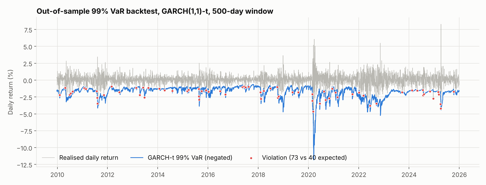
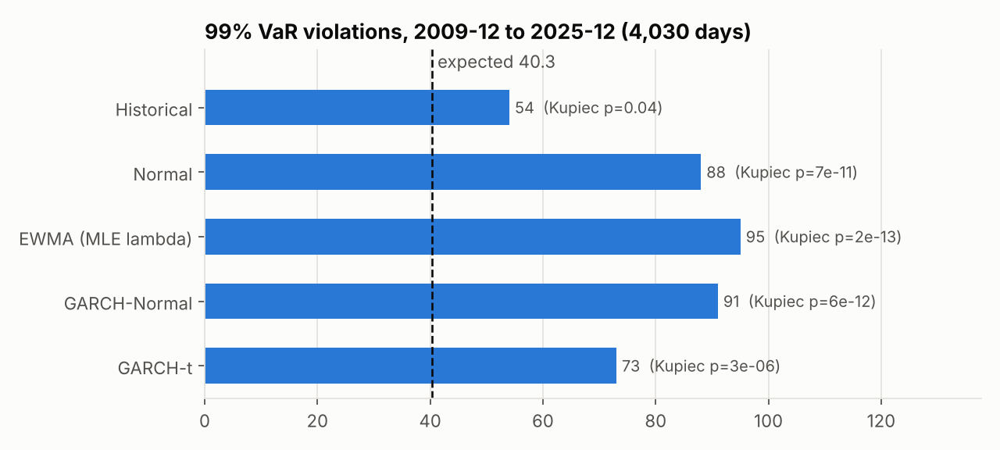
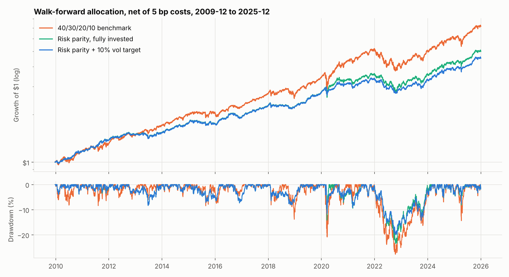

# Market Risk Analytics & Model Validation Engine

A reproducible Python engine for measuring and validating market risk on a
multi-asset ETF portfolio (SPY 40%, QQQ 30%, TLT 20%, GLD 10%, $1,000,000).

Every forecast is produced out of sample (no look-ahead), every result in this README is
generated by the scripts in `scripts/` from a hash-verified data snapshot, and the models are
challenged in a full **[model validation report](docs/model_validation_report.md)**
([PDF](docs/model_validation_report.pdf)).


## Key results

**VaR backtest, 4,030 out-of-sample days (2009-12 to 2025-12), 500-day window, refit every 21 days.**
Expected 99% violations: 40.3.

| Model | 99% violations | Kupiec p | Independence p | ES ratio | Basel red-zone share |
|---|---:|---:|---:|---:|---:|
| Historical simulation | 54 | 0.039 | 6.6e-05 | 1.07 | 1.0% |
| Normal | 88 | 6.6e-11 | 1.2e-04 | 1.29 | 23.5% |
| EWMA (MLE lambda) | 95 | 1.7e-13 | 0.102 | 1.16 | 6.3% |
| GARCH(1,1)-Normal | 91 | 5.5e-12 | 0.217 | 1.14 | 6.4% |
| **GARCH(1,1)-t (primary)** | **73** | 3.3e-06 | 0.054 | **1.01** | **0.4%** |

- No Phase 3 model achieves correct 99% coverage; GARCH-t is the best conditional model and its ES
  matches realised tail losses. Historical simulation has fewer violations but they cluster.
- GARCH-t over-violates at 95% (6.3%): a single symmetric t cannot fit both the shoulder and
  the tail.

**Phase 3b tail models** (same dates and set-up; full results in
[reports/phase3b_report.md](reports/phase3b_report.md)):

| Model | 95% viol. (exp 201.5) | 99% viol. (exp 40.3) | 99% Kupiec p | 99% CC p | 99% ES ratio |
|---|---:|---:|---:|---:|---:|
| GARCH(1,1)-skew-t | 215 | 60 | 0.004 | 0.0007 | 1.00 |
| GJR-GARCH-t | 244 | 72 | 6.2e-06 | 1.5e-05 | 1.01 |
| GJR-GARCH-skew-t | 205 | 53 | 0.055 | 0.018 | 0.99 |
| EGARCH-t | 256 | 83 | 3.3e-09 | 7.7e-09 | 1.02 |
| FHS, GARCH-t filter | 201 | 55 | 0.027 | 0.002 | 1.01 |
| FHS, GJR-t filter | 208 | 53 | 0.055 | 0.018 | 1.00 |

- The 99% shortfall of the parametric models is mostly **tail shape** (left skew), not volatility
  dynamics: adding skewness cuts GARCH violations 73 -> 60, while adding leverage alone (GJR-t 72,
  EGARCH-t 83) does not help.
- GJR-skew-t and FHS-GJR are the only models not rejected by Kupiec at 5% on the primary set-up
  and fix the 95% over-violation; with a 1,000-day window FHS-GJR passes Kupiec, independence and
  conditional coverage at both 95% and 99%. Six candidates were tried, so these p-values carry a
  multiple-testing caveat.
- Stress: GFC -30.1% (-$301k), 2022 rate shock -26.8% (bonds fell with stocks), COVID -19.4%.
- Attribution: equities are 70% of the capital and 87.5% of the 99% VaR.
- Allocation overlay (risk parity + 10% vol target + cash): CAGR 9.9%, vol 8.2%, max DD -19.9%
  vs 13.1% / 12.5% / -27.7% for the static 40/30/20/10 portfolio.



| | |
|---|---|
|  |  |
|  |  |

## Interactive dashboard

```bash
pip install -e ".[dashboard]"
streamlit run app/streamlit_app.py
```

Five tabs: risk overview (live VaR/ES for any weights), VaR backtest explorer, stress testing
(historical, custom hypothetical shocks, conditional shocks), Euler risk attribution, and the
allocation walk-forward.

## Project phases
| Phase | Scope |
|---|---|
| 1 | Data pipeline, data quality checks, portfolio returns, Historical / Normal VaR & ES |
| 2 | EWMA (MLE lambda), GARCH(1,1)-t vs Normal, Ledoit-Wolf shrinkage |
| 3 | Rolling out-of-sample backtest (2009-12 to 2025-12), Kupiec, Christoffersen |
| 3b | Tail-model extensions: skewed-t (Hansen), GJR-GARCH, EGARCH, filtered historical simulation |
| 4 | Historical / hypothetical / conditional stress tests; Euler VaR & ES attribution |
| 5 | Risk parity + volatility targeting with cash and threshold rebalancing; min-variance / min-CVaR benchmarks |
| 6 | Streamlit dashboard, Basel traffic light, model validation report, CI |

## Quick start
```bash
pip install -e ".[dev,dashboard]"
pytest                          # 164 unit tests (offline)
python scripts/run_phase1.py    # uses data/raw/prices.csv snapshot
python scripts/run_phase1.py --refresh   # re-download from Yahoo Finance
python scripts/run_phase2.py    # volatility models on the last 1,000-day window
python scripts/run_phase3.py    # rolling backtest (~1 min on 4 cores)
python scripts/run_phase3b.py   # tail models: skew-t, GJR, EGARCH, FHS (~20 min; --skip-daily ~3 min)
python scripts/run_phase4.py    # stress tests and risk attribution
python scripts/run_phase5.py    # walk-forward allocation backtest
python scripts/run_phase6.py    # Basel traffic light
python scripts/make_figures.py  # static figures in reports/figures/
```

## Key assumptions (all in `config.yaml`)
- **Data**: Yahoo Finance adjusted close (total return), 2006-01-01 to 2025-12-31.
  The download is snapshotted with a SHA-256 hash because Yahoo revises adjusted
  prices retroactively.
- **Returns**: simple returns for the portfolio (they aggregate linearly across assets).
- **Weights**: constant (daily rebalanced to target).
- **Sign convention**: VaR and ES are reported as positive losses.
  `VaR_a = -q_{1-a}(P&L)`, `ES_a = -E[P&L | P&L <= -VaR_a]`.
- **Horizon**: 1 day.
- **Volatility models**: rolling 1,000-day estimation window; GARCH(1,1) with Student-t
  innovations is primary, Normal GARCH is the benchmark; EWMA lambda is chosen by Gaussian
  MLE inside the window only; Ledoit-Wolf shrinkage with identity and constant-correlation targets.
- **Backtesting**: primary set-up is a 500-day rolling window, GARCH/EWMA-lambda refit every
  21 trading days with daily variance updates; sensitivity runs use daily refits and 250 / 1,000-day
  windows. All set-ups forecast the same 4,030 days. Tests at 5% (primary) and 1% significance.
- **Stress testing**: historical scenarios replayed buy-and-hold (primary) and daily rebalanced
  (benchmark); attribution uses the EWMA covariance (MLE lambda) as of the last date.
- **Allocation**: daily EWMA risk forecast (lambda by MLE every 21 days on a 500-day window);
  risk-parity weights scaled to a 10% annual vol target, remainder in T-bills (^IRX); trade only when
  any weight drifts more than 5pp from target; information at the close of t-1 drives day t.
- **Data quality**: issues are reported, never silently fixed; no forward-filling;
  extreme returns are flagged but kept.

## Layout
```
config.yaml            all modelling parameters
src/mre/data/          download + cache (loader.py), quality checks (quality.py)
src/mre/portfolio.py   asset and portfolio returns, P&L
src/mre/risk/var.py    Historical / Normal VaR and ES
src/mre/models/        ewma.py, garch.py, shrinkage.py
src/mre/stress/        scenarios.py (historical, hypothetical, conditional)
src/mre/attribution/   euler.py (component / marginal / incremental VaR, component ES)
src/mre/optimization/  optimizers.py, dynamic.py (vol target, cash, threshold), backtest.py
src/mre/backtest/      rolling.py (out-of-sample forecasts), coverage_tests.py (Kupiec, Christoffersen)
src/mre/backtest/traffic_light.py  Basel traffic-light zones
scripts/               run_phase1..6.py pipelines, make_figures.py
app/streamlit_app.py   dashboard
docs/                  model validation report (EN), methodology and derivations (ZH)
reports/               generated reports, CSVs and figures
tests/                 pytest suite
```
