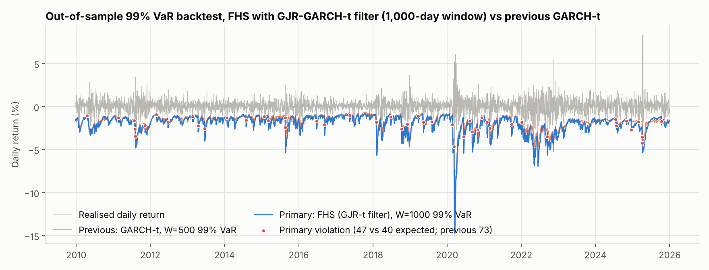
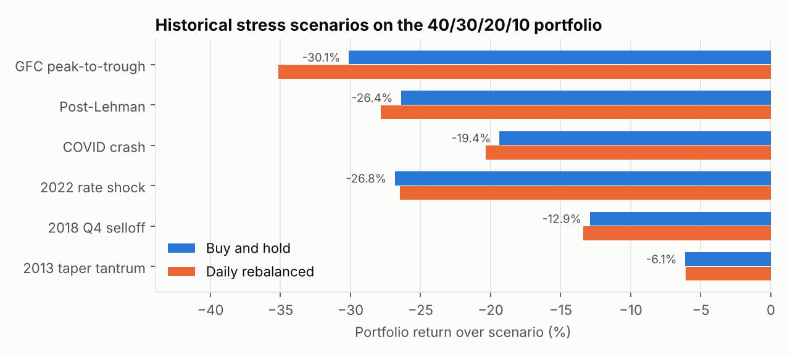
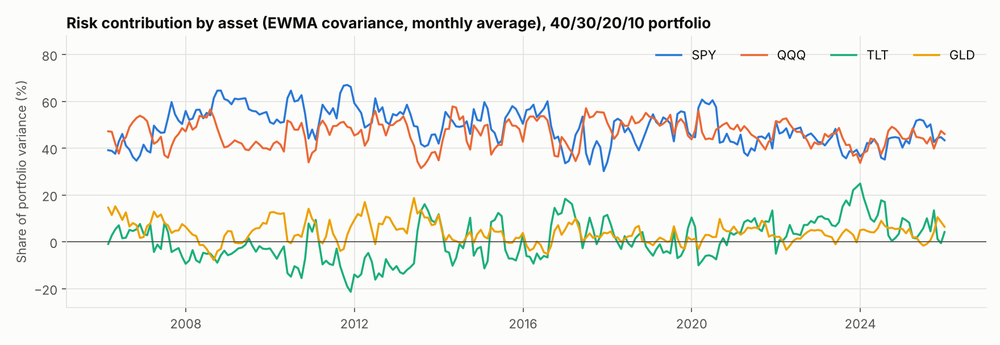

# Market Risk Analytics & Model Validation Engine

A reproducible Python engine for measuring and validating market risk on a
multi-asset ETF portfolio (SPY 40%, QQQ 30%, TLT 20%, GLD 10%, $1,000,000).

Every forecast is produced out of sample (no look-ahead), every result in this README is
generated by the scripts in `scripts/` from a hash-verified data snapshot, and the models are
challenged in a full **[model validation report](docs/model_validation_report.md)**
([PDF](docs/model_validation_report.pdf)).


## Key results

**Primary VaR/ES model: filtered historical simulation with a GJR-GARCH-t filter on a 1,000-day
window (FHS-GJR).** It replaced GARCH(1,1)-t in Phase 3b; see
[why the model was changed](docs/model_validation_report.md#65-model-change-garch-t-to-fhs-gjr).

**VaR backtest, 4,030 out-of-sample days (2009-12 to 2025-12), refit every 21 days.**
Expected violations: 201.5 at 95%, 40.3 at 99%. CC = Christoffersen conditional coverage.

| Model | 95% viol. | 99% viol. | 99% Kupiec p | 99% Ind. p | 99% CC p | ES ratio | Basel red-zone share |
|---|---:|---:|---:|---:|---:|---:|---:|
| **FHS-GJR, W=1000 (primary)** | **201** | **47** | **0.301** | **0.124** | **0.179** | **0.99** | **0.0%** |
| GJR-skew-t, W=500 (alternative) | 205 | 53 | 0.055 | 0.037 | 0.018 | 0.99 | 0.0% |
| GARCH(1,1)-t, W=500 (previous primary) | 254 | 73 | 3.3e-06 | 0.054 | 3.2e-06 | 1.01 | 0.4% |
| Historical simulation, W=500 | 204 | 54 | 0.039 | 6.6e-05 | 4.2e-05 | 1.07 | 1.0% |
| Normal, W=500 | 204 | 88 | 6.6e-11 | 1.2e-04 | 3.3e-13 | 1.29 | 23.5% |
| EWMA (MLE lambda), W=500 | 219 | 95 | 1.7e-13 | 0.102 | 4.2e-13 | 1.16 | 6.3% |
| GARCH(1,1)-Normal, W=500 | 231 | 91 | 5.5e-12 | 0.217 | 2.2e-11 | 1.14 | 6.4% |

- FHS-GJR is the only model that passes Kupiec, independence and conditional coverage at both
  95% and 99%. It is in the Basel green zone in 80.6% of rolling 250-day windows (GARCH-t 48.7%),
  never red, and green in the latest window. Its average 99% VaR is about 13% higher than
  GARCH-t's ($19.7k vs $17.4k).
- Why GARCH-t failed: the portfolio's left tail is skewed. Adding skewness cuts GARCH violations
  from 73 to 60; adding a leverage effect alone does not help (GJR-t 72, EGARCH-t 83). FHS takes the
  tail shape from the filtered residuals instead of assuming one.
- Caveat: the 1,000-day window and the model were chosen after seeing these out-of-sample results,
  and six new candidates were tried. The model has to prove itself on new data (see monitoring).
  Full comparison: [reports/phase3b_report.md](reports/phase3b_report.md).
- Stress: GFC -30.1% (-$301k), 2022 rate shock -26.8% (bonds fell with stocks), COVID -19.4%.
- Attribution: equities are 70% of the capital and 87.5% of the 99% VaR.
- Allocation overlay (risk parity + 10% vol target + cash): CAGR 9.9%, vol 8.2%, max DD -19.9%
  vs 13.1% / 12.5% / -27.7% for the static 40/30/20/10 portfolio.



| | |
|---|---|
|  |  |
|  |  |

## Interactive dashboard

```bash
pip install -e ".[dashboard]"
streamlit run app/streamlit_app.py
```

Five tabs: risk overview (live VaR/ES for any weights), VaR backtest explorer, stress testing
(historical, custom hypothetical shocks, conditional shocks), Euler risk attribution, and the
allocation walk-forward.

## Learning notebooks (Chinese)

[`learning/`](learning/) has five short interactive notebooks that explain the core ideas intuition-first, using this repo's data and code: VaR vs ES, EWMA/GARCH, GJR + FHS, Kupiec/Christoffersen backtesting, and why ES is subadditive. They reproduce the reported numbers (e.g. 73 vs 40.3 breaches for GARCH-t, 47 for FHS-GJR).

## Project phases
| Phase | Scope |
|---|---|
| 1 | Data pipeline, data quality checks, portfolio returns, Historical / Normal VaR & ES |
| 2 | EWMA (MLE lambda), GARCH(1,1)-t vs Normal, Ledoit-Wolf shrinkage |
| 3 | Rolling out-of-sample backtest (2009-12 to 2025-12), Kupiec, Christoffersen |
| 3b | Tail-model extensions: skewed-t (Hansen), GJR-GARCH, EGARCH, filtered historical simulation |
| 4 | Historical / hypothetical / conditional stress tests; Euler VaR & ES attribution |
| 5 | Risk parity + volatility targeting with cash and threshold rebalancing; min-variance / min-CVaR benchmarks |
| 6 | Streamlit dashboard, Basel traffic light, model validation report, CI |

## Quick start
```bash
pip install -e ".[dev,dashboard]"
pytest                          # 185 unit tests (offline)
python scripts/run_phase1.py    # uses data/raw/prices.csv snapshot
python scripts/run_phase1.py --refresh   # re-download from Yahoo Finance
python scripts/run_phase2.py    # volatility models on the last 1,000-day window
python scripts/run_phase3.py    # rolling backtest (~1 min on 4 cores)
python scripts/run_phase3b.py   # tail models: skew-t, GJR, EGARCH, FHS (~20 min; --skip-daily ~3 min)
python scripts/run_phase3c.py   # conditional EVT (FHS-EVT) and DCC-GARCH (~10 min)
python scripts/run_phase4.py    # stress tests and risk attribution
python scripts/run_phase5.py    # walk-forward allocation backtest
python scripts/run_phase6.py    # Basel traffic light (needs run_phase3 and run_phase3b outputs)
python scripts/make_figures.py  # static figures in reports/figures/
```

## Key assumptions (all in `config.yaml`)
- **Data**: Yahoo Finance adjusted close (total return), 2006-01-01 to 2025-12-31.
  The download is snapshotted with a SHA-256 hash because Yahoo revises adjusted
  prices retroactively.
- **Returns**: simple returns for the portfolio (they aggregate linearly across assets).
- **Weights**: constant (daily rebalanced to target).
- **Sign convention**: VaR and ES are reported as positive losses.
  `VaR_a = -q_{1-a}(P&L)`, `ES_a = -E[P&L | P&L <= -VaR_a]`.
- **Horizon**: 1 day.
- **Volatility models**: rolling 1,000-day estimation window; GARCH(1,1) with Student-t
  innovations is primary, Normal GARCH is the benchmark; EWMA lambda is chosen by Gaussian
  MLE inside the window only; Ledoit-Wolf shrinkage with identity and constant-correlation targets.
- **Official VaR model** (`var_model` in config): FHS with a GJR-GARCH-t filter, 1,000-day
  window and residual pool, refit every 21 days with daily variance updates; GJR-skew-t (W=500)
  is the parametric alternative, GARCH-t (W=500) the previous model kept as benchmark.
- **Phase 3c challengers**: conditional EVT (GPD on the FHS residual pool, 90% threshold) and
  DCC-GARCH(1,1) with GJR-t marginals per asset. DCC-EVT (W=1000) has 39 violations at 99%
  (expected 40.3) vs 47 for FHS-GJR and passes all tests; it is a monitored challenger, not the
  official model: the gap is within multiple-testing noise, so it is promoted only under rules
  fixed in advance (`docs/model_validation_report.md` sections 6.6 and 12; `reports/phase3c_report.md`).
- **Backtesting**: primary set-up is a 500-day rolling window, GARCH/EWMA-lambda refit every
  21 trading days with daily variance updates; sensitivity runs use daily refits and 250 / 1,000-day
  windows. All set-ups forecast the same 4,030 days. Tests at 5% (primary) and 1% significance.
- **Stress testing**: historical scenarios replayed buy-and-hold (primary) and daily rebalanced
  (benchmark); attribution uses the EWMA covariance (MLE lambda) as of the last date.
- **Allocation**: daily EWMA risk forecast (lambda by MLE every 21 days on a 500-day window);
  risk-parity weights scaled to a 10% annual vol target, remainder in T-bills (^IRX); trade only when
  any weight drifts more than 5pp from target; information at the close of t-1 drives day t.
- **Data quality**: issues are reported, never silently fixed; no forward-filling;
  extreme returns are flagged but kept.

## Layout
```
config.yaml            all modelling parameters
src/mre/data/          download + cache (loader.py), quality checks (quality.py)
src/mre/portfolio.py   asset and portfolio returns, P&L
src/mre/risk/var.py    Historical / Normal VaR and ES
src/mre/models/        ewma.py, garch.py, shrinkage.py
src/mre/stress/        scenarios.py (historical, hypothetical, conditional)
src/mre/attribution/   euler.py (component / marginal / incremental VaR, component ES)
src/mre/optimization/  optimizers.py, dynamic.py (vol target, cash, threshold), backtest.py
src/mre/backtest/      rolling.py (out-of-sample forecasts), coverage_tests.py (Kupiec, Christoffersen)
src/mre/backtest/traffic_light.py  Basel traffic-light zones
scripts/               run_phase1..6.py pipelines, make_figures.py
app/streamlit_app.py   dashboard
docs/                  model validation report (EN), methodology and derivations (ZH)
reports/               generated reports, CSVs and figures
tests/                 pytest suite
```
