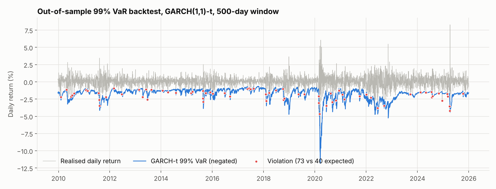
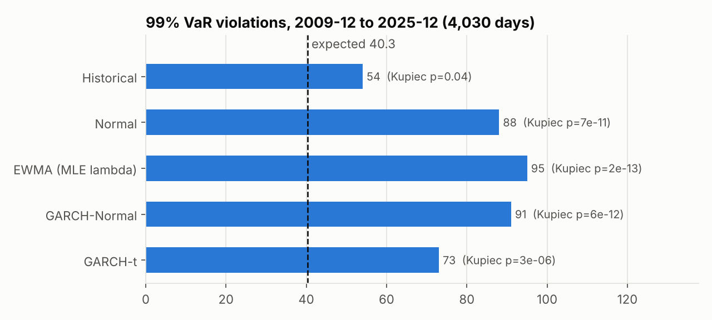
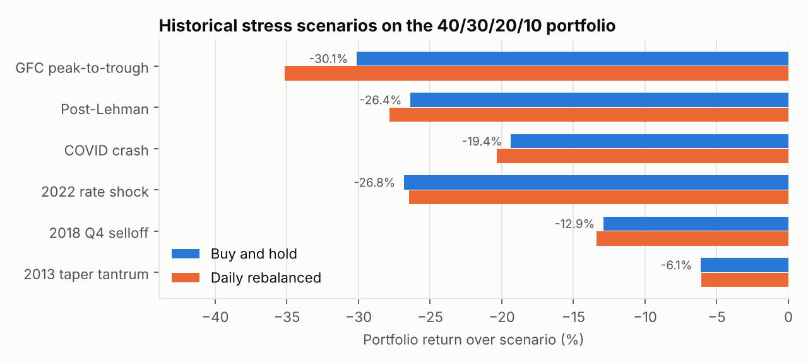
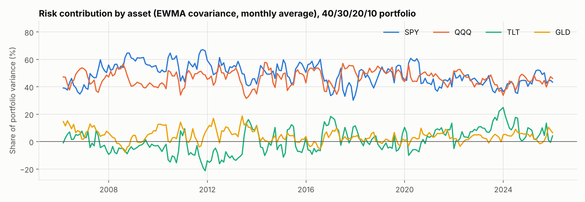
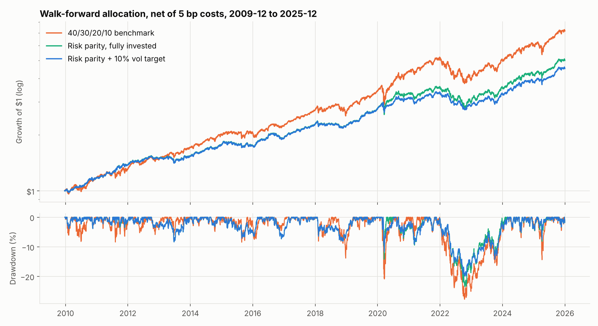

# Model Validation Report

**Market Risk Analytics & Model Validation Engine**\
Portfolio: SPY 40% / QQQ 30% / TLT 20% / GLD 10%, notional $1,000,000\
Data: daily adjusted close, 2006-01-03 to 2025-12-31 (5,031 prices, 5,030 returns)\
Out-of-sample period: 2009-12-23 to 2025-12-31 (4,030 forecast days)

The structure follows the elements of the US supervisory guidance on model risk management
(SR 11-7): conceptual soundness, ongoing monitoring / outcomes analysis, benchmarking and
sensitivity analysis, and a statement of limitations. Every number in this report is produced
by the scripts in `scripts/` from the committed data snapshot; the source file is given next
to each table. Nothing has been tuned after looking at the out-of-sample results, except where
this is stated explicitly.

---

## 1. Executive summary

| Item | Finding |
|---|---|
| Model in scope | 1-day 95% / 99% VaR and ES for a static ETF portfolio; GARCH(1,1) with Student-t innovations is the primary model, with Historical, Normal, EWMA and GARCH-Normal as challengers. |
| Overall rating | **Fit for purpose with conditions.** No model passes unconditional coverage at 99% in the primary set-up. GARCH-t has the fewest 99% violations among conditional models (73 vs 40.3 expected), no significant clustering at 5% (p = 0.054), and the most accurate tail-loss severity (ES ratio 1.01). |
| Main weakness | All models under-forecast the 99% tail. GARCH-t over-violates at 95% (6.30% vs 5%), which suggests the fitted Student-t shape is too light in the body/shoulder and too heavy relative to the 95% quantile. |
| Regulatory view | On rolling 250-day windows, GARCH-t is in the Basel red zone in 0.4% of windows (Historical 1.0%, Normal 23.5%). The latest window (2025) is yellow for every model (5 exceptions for GARCH-t). |
| Recommendations | (1) Add filtered historical simulation (GARCH-filtered empirical residuals) as the next challenger; (2) evaluate a skewed-t innovation; (3) apply a capital-style multiplier or VaR buffer while the 99% under-coverage persists; (4) add a formal ES backtest (Acerbi-Szekely Z2). |

---

## 2. Model purpose and scope

- **Intended use**: daily market-risk measurement for a multi-asset ETF portfolio: limit
  monitoring (VaR), tail-loss severity (ES), stress testing, risk attribution and a
  risk-based allocation overlay.
- **Horizon / confidence**: 1 trading day; 95% and 99%. VaR and ES are reported as positive losses:
  `VaR_a = -q_{1-a}(P&L)`, `ES_a = -E[P&L | P&L <= -VaR_a]`.
- **Portfolio treatment**: constant weights (daily rebalanced to target) for VaR; buy-and-hold
  for historical stress scenarios (rebalanced shown as a benchmark).
- **Out of scope**: intraday risk, options/non-linear positions, multi-day horizons
  (no square-root-of-time scaling is claimed), liquidity risk, counterparty risk.

## 3. Data

| Aspect | Treatment | Evidence |
|---|---|---|
| Source | Yahoo Finance via `yfinance`, `auto_adjust=True` (total-return adjusted close) | `src/mre/data/loader.py` |
| Reproducibility | Download snapshotted to `data/raw/prices.csv` with a SHA-256 hash in `prices.meta.json`; loading verifies the hash, because Yahoo revises adjusted prices retroactively | `tests/test_loader.py` |
| Quality checks | Missing values, non-positive prices, stale runs (>= 5 identical prices), calendar gaps (> 5 days), extreme returns (\|r\| > 15%) | `src/mre/data/quality.py`, 10 tests |
| Result | **PASSED**: 5,031 rows, all four tickers on every date, 0 rows dropped by alignment, no issues flagged | `reports/phase1_report.md` |
| Policy | Issues are reported, never silently fixed; no forward filling; extreme returns kept | config `quality` |
| Cash rate | 13-week T-bill (`^IRX`), quote at t-1 / 252 per day, used for the allocation overlay and Sharpe ratios | `get_cash_rate` |

Stylised facts that drive model choice (portfolio, full sample): annualised vol 13.77%,
skewness 0.11, **excess kurtosis 11.11**; worst day -6.85% (2020-03-12). Ljung-Box on
squared returns (last 1,000 days, 10 lags): Q = 100.7, p = 3.9e-17, i.e. strong volatility
clustering. Both facts reject an i.i.d. Normal model on conceptual grounds before any backtest.

## 4. Conceptual soundness

### 4.1 Models

| Model | Specification | Parameters | Role |
|---|---|---|---|
| Historical simulation | Empirical quantile (linear interpolation) and tail mean of the trailing window | window W | Challenger, non-parametric |
| Normal (variance-covariance) | `VaR = -(mu + sigma z_{1-a})`, `ES = -mu + sigma phi(z_a)/(1-a)`, sample mean and ddof = 1 | window W | Challenger, textbook baseline |
| EWMA | `sigma^2_t = lambda sigma^2_{t-1} + (1-lambda) r^2_{t-1}`, zero mean, Normal quantile | lambda by Gaussian QMLE inside the window, bounds [0.80, 0.9995], 30-day burn-in | Challenger, RiskMetrics family |
| GARCH(1,1)-Normal | `sigma^2_t = omega + alpha e^2_{t-1} + beta sigma^2_{t-1}`, constant mean | MLE via `arch` | Benchmark |
| **GARCH(1,1)-t** | Same variance equation, standardised Student-t innovations (unit variance) | MLE, nu estimated | **Primary** |

Covariance estimators used for attribution, stress and allocation: sample, EWMA (common
lambda by multivariate Gaussian MLE), and Ledoit-Wolf shrinkage (identity and
constant-correlation targets). Full derivations are in `docs/methodology_zh.md`.

### 4.2 Key assumptions and their justification

| Assumption | Justification | Risk if wrong |
|---|---|---|
| Simple returns at portfolio level | Portfolio return is exactly `w'r`; log returns do not aggregate across assets | None for a 1-day horizon |
| Constant weights for VaR | Standard for a target-weight mandate; isolates the risk model from trading | Drift between rebalances ignored |
| Student-t innovations | Excess kurtosis of 11.1; AIC favours t over Normal by 27.1 points on the last 1,000 days | Symmetric t cannot capture skew |
| AIC/BIC instead of an LR test (t vs Normal) | nu = infinity is on the boundary of the parameter space, so the LR statistic is not chi-square | n/a |
| Zero mean for EWMA | RiskMetrics convention; daily means are small relative to volatility | Slightly conservative in up-trends |
| Rolling window W = 500, refit every 21 days | Balances parameter stability against adaptivity; sensitivity to 250 / 1,000 and to daily refits is reported | Regime shifts inside the window |
| Gaussian Euler attribution | Exact additivity of component VaR under elliptical distributions | Tail dependence understated (cross-checked with historical component ES) |

### 4.3 Look-ahead and leakage controls

- Every forecast for day t uses returns strictly before t. The rolling engine slices
  `returns[:t]` and refits on `returns[t-W:t]`; this is tested by changing returns after a
  forecast date and checking that earlier forecasts do not change (`tests/test_rolling.py`).
- EWMA lambda and GARCH parameters are re-estimated inside each window only.
- The allocation overlay uses information at the close of t-1 to set day-t holdings;
  the cash rate also uses the t-1 quote (`tests/test_dynamic.py`).
- The rolling risk-contribution path uses a fixed lambda = 0.94 so that no parameter is
  estimated with future data.
- The full-sample statistics in Phase 1 are explicitly labelled descriptive / in-sample and
  are never used as forecasts.

## 5. Implementation verification

The implementation is verified by **145 unit tests** (offline, synthetic or cached data),
run on every push by GitHub Actions (`.github/workflows/tests.yml`).

| Module | Test functions | Examples of what is verified |
|---|---:|---|
| Data loader / quality | 15 | Hash mismatch detected; cache used without network; inclusive end date; each quality rule fires on a constructed defect; checks never mutate input |
| Portfolio / VaR | 20 | Hand-computed returns, quantiles and ES; Normal closed forms; ES >= VaR; positive homogeneity and translation invariance; no look-ahead in returns |
| EWMA / GARCH / shrinkage | 21 | Hand-computed recursion; MLE recovers the true lambda on simulated data; GARCH-t parameter recovery; standardised t has unit variance and correct ES; LW identity target matches scikit-learn |
| Rolling backtest / coverage tests | 19 | No look-ahead; parallel equals serial; daily variance update between refits; Kupiec and Christoffersen against hand-worked values; test size under the null and power against under-coverage |
| Stress / attribution | 17 | Euler components sum to total; marginal VaR equals the numerical derivative; conditional shock matches simulation; buy-and-hold hand check |
| Optimisation / walk-forward / dynamic | 29 | Two-asset min-variance closed form; equal risk contributions; min-CVaR equals historical ES and beats a grid; threshold rule trades only on large deviations; covariance forecasts use the trailing window only |
| Basel traffic light | 3 | Zone boundaries; exception counting on rolling windows |
| Dashboard | 2 | Streamlit app renders all five tabs; changing weights recomputes risk |
| Config | 2 | Default config loads; bad weights rejected |

Some functions are parametrised, giving 145 test cases in total.

GARCH is estimated on returns scaled by 100 for numerical stability; the reported
log-likelihood includes the Jacobian correction so that AIC/BIC are comparable with models
fitted on unscaled returns.

## 6. Outcomes analysis: VaR backtesting

### 6.1 Design

- 4,030 out-of-sample days (2009-12-23 to 2025-12-31), identical for every model and set-up.
- A violation (hit) on day t: realised loss > VaR_t.
- Tests: Kupiec proportion-of-failures (chi-square(1)), Christoffersen independence
  (chi-square(1)), conditional coverage (chi-square(2)); significance 5% (primary) and 1%.
- ES accuracy (descriptive): mean realised loss on violation days / mean forecast ES on those
  days. A value near 1 is good; above 1 means ES understates the tail.

### 6.2 Primary set-up (W = 500, refit every 21 days)

Source: `reports/phase3_backtest_results.csv`.

| Model | 95% hits (exp. 201.5) | Kupiec p | CC p | 99% hits (exp. 40.3) | Kupiec p | Ind. p | CC p | ES ratio 99% |
|---|---:|---:|---:|---:|---:|---:|---:|---:|
| Historical | 204 | 0.857 | 0.036 | 54 | 0.039 | 6.6e-05 | 4.2e-05 | 1.07 |
| Normal | 204 | 0.857 | 0.003 | 88 | 6.6e-11 | 1.2e-04 | 3.3e-13 | 1.29 |
| EWMA (MLE lambda) | 219 | 0.212 | 0.059 | 95 | 1.7e-13 | 0.102 | 4.2e-13 | 1.16 |
| GARCH-Normal | 231 | 0.037 | 0.112 | 91 | 5.5e-12 | 0.217 | 2.2e-11 | 1.14 |
| **GARCH-t** | 254 | 0.00026 | 0.001 | **73** | 3.3e-06 | 0.054 | 3.2e-06 | **1.01** |



**Findings**

1. **99% coverage is rejected for every model at 5%.** Even the best conditional model
   (GARCH-t, 1.81% violation rate) breaches 1.8 times as often as expected.
2. **Historical simulation has the best 99% count (54) but fails independence badly**
   (p = 6.6e-05): its violations cluster because a 500-day empirical quantile reacts slowly
   to volatility regimes. This is the classic weakness of unfiltered HS.
3. **Conditional models fix clustering.** EWMA, GARCH-Normal and GARCH-t do not reject
   independence at 5% at 99%; the fat-tailed GARCH-t cuts violations from 91 (GARCH-Normal)
   to 73.
4. **GARCH-t over-violates at 95%** (6.30%, Kupiec p = 0.00026) while the Normal-based models
   pass at 95%. A likely explanation is that a unit-variance Student-t with a low nu (median 6.5
   across refits) has a smaller 95% quantile than the Normal, so a shape fitted to the extreme
   tail is too narrow at the shoulder. This is a known trade-off of a single symmetric t.
5. **ES severity**: GARCH-t ES matches realised tail losses on violation days (ratio 1.01);
   for the Normal model realised tail losses exceed forecast ES by 29%.

### 6.3 Violations over time



Violations concentrate in 2018 (Volmageddon / Q4 sell-off), 2020 (COVID) and 2022 (joint
stock-bond sell-off). In 2018 the Normal model had 22 violations against 2.5 expected.

### 6.4 Basel traffic light

Source: `reports/phase6_traffic_light.md` (`scripts/run_phase6.py`). 99% VaR, rolling
250-day windows (3,781 overlapping windows); green 0-4 exceptions, yellow 5-9, red 10+.

| Model | Green | Yellow | Red | Max exceptions | Last 250 days | Last zone |
|---|---:|---:|---:|---:|---:|---|
| Historical | 59.9% | 39.1% | 1.0% | 10 | 5 | yellow |
| Normal | 48.2% | 28.3% | 23.5% | 23 | 6 | yellow |
| EWMA (MLE lambda) | 24.1% | 69.6% | 6.3% | 11 | 5 | yellow |
| GARCH-Normal | 29.8% | 63.8% | 6.4% | 11 | 6 | yellow |
| **GARCH-t** | 48.7% | 50.8% | **0.4%** | 10 | 5 | yellow |

GARCH-t almost never reaches the red zone; the Normal model would have been in the red zone
almost a quarter of the time. Under the Basel framework a yellow zone with 5 exceptions adds
0.40 to the capital multiplier (3.0 to 3.4).

## 7. Benchmarking and sensitivity analysis

### 7.1 Estimation window and refit frequency (99% violations, expected 40.3)

| Model | W=250 | **W=500 (primary)** | W=1000 | W=500, daily refit |
|---|---:|---:|---:|---:|
| Historical | 54 | 54 | 42 | - |
| Normal | 94 | 88 | 77 | - |
| EWMA | 96 | 95 | 92 | - |
| GARCH-Normal | 104 | 91 | 86 | 94 |
| GARCH-t | 79 | 73 | 68 | 74 |

- Ranking is stable: GARCH-t is the best conditional model in every set-up.
- Longer windows reduce 99% violations for every model. Historical with W = 1,000 passes
  Kupiec at 99% (42 hits, p = 0.79) but still fails independence (p = 5.5e-05).
- Daily refitting changes GARCH results by 1-3 violations, so the monthly refit is not a
  material simplification, and it needs about 21 times fewer GARCH fits.
- The primary window was fixed at 500 before the backtest was run; W = 1,000 looks better
  ex post, but switching to it now would be a choice made with knowledge of the results.

### 7.2 Parameter stability (primary GARCH-t, 192 refits)

- Persistence alpha + beta: median 0.979; 6.8% of days at >= 0.999 (near-integrated fits,
  typically right after volatility spikes).
- nu: median 6.5, range 4.1 to 48.9. The upper end corresponds to calm windows where the
  t collapses towards the Normal.
- EWMA lambda (MLE): median 0.920, range 0.846 to 0.9995; the RiskMetrics value 0.94 is
  inside the range but not the typical estimate for this portfolio.

### 7.3 Covariance estimator (attribution, 2025-12-31, 99% VaR)

| Covariance | 99% VaR | SPY | QQQ | TLT | GLD |
|---|---:|---:|---:|---:|---:|
| EWMA (MLE lambda = 0.964) [primary] | $14,774 | 42.7% | 44.8% | 4.3% | 8.2% |
| Sample (500d) | $19,696 | 47.1% | 44.6% | 5.1% | 3.3% |
| Ledoit-Wolf const-corr (500d) | $19,508 | 46.8% | 44.3% | 5.5% | 3.5% |

The level differs by about 25% between estimators (EWMA reacts to the quieter late-2025
market), but the split is robust: **equities carry about 87-92% of VaR with 70% of the
capital.** Ledoit-Wolf shrinkage is small (delta ~ 0.02) because four assets and 500
observations give a well-conditioned sample covariance.

## 8. Stress testing

Source: `reports/phase4_report.md`. Buy-and-hold, $1,000,000.

| Scenario | Period | Portfolio | P&L |
|---|---|---:|---:|
| GFC peak-to-trough | 2007-10-09 to 2009-03-09 | -30.1% | -$301,358 |
| 2022 rate shock | 2021-12-31 to 2022-10-12 | -26.8% | -$268,330 |
| Post-Lehman | 2008-09-12 to 2008-11-20 | -26.4% | -$263,813 |
| COVID crash | 2020-02-19 to 2020-03-23 | -19.4% | -$193,767 |
| 2018 Q4 selloff | 2018-09-20 to 2018-12-24 | -12.9% | -$129,158 |
| 2013 taper tantrum | 2013-05-21 to 2013-06-24 | -6.1% | -$61,198 |



Key observation: in 2022 the bond hedge failed (TLT -31.2%), so the loss was almost as large
as the GFC drawdown. The conditional stress test makes the same point: a -10% SPY shock costs
$63k with the 2017 or GFC covariance (negative stock-bond correlation) but $87k with the
current EWMA covariance (correlation +0.16). **Diversification assumptions are regime
dependent, and a VaR model calibrated in a negative-correlation regime will understate risk
in an inflation regime.**

## 9. Risk attribution



As of 2025-12-31 equities hold 70% of the capital but 87.5% of the 99% VaR (EWMA covariance); TLT and GLD hold 30% of the capital and 12.5% of the risk. In 2008-2012 TLT's contribution was negative, i.e. it hedged the portfolio; since 2021 it has been positive.

Euler decomposition is exact (components sum to VaR) under the Gaussian assumption. The
historical component ES at 99% is used as a non-parametric cross-check: it gives the same
ordering (SPY 50.9%, QQQ 43.0%, TLT 4.4%, GLD 1.7%) but rests on only 5 tail days, so it
is noisy by construction.

## 10. Allocation overlay (Phase 5) as a use of the risk model

The EWMA covariance forecast drives a risk-parity allocation scaled to a 10% volatility
target with cash, rebalanced when any weight drifts by more than 5pp. This is a downstream
use of the risk model, so its out-of-sample behaviour is evidence of the forecast's value.

| Strategy (2009-12-23 to 2025-12-31, 5 bp costs) | CAGR | Vol | Sharpe (excess) | Max DD | 2022 | Max 63d vol |
|---|---:|---:|---:|---:|---:|---:|
| RP + VT 10%, threshold 5pp [primary] | 9.9% | 8.2% | 1.02 | -19.9% | -15.8% | 15.5% |
| RP, fully invested | 10.6% | 9.0% | 1.01 | -23.5% | -17.5% | 22.1% |
| Min variance (EWMA cov), monthly | 10.2% | 8.5% | 1.03 | -21.5% | -14.1% | 22.3% |
| Benchmark 40/30/20/10, monthly | 13.1% | 12.5% | 0.94 | -27.7% | -23.5% | 37.8% |



Interpretation: the overlay delivers a lower and more stable risk level (worst 63-day vol
15.5% vs 37.8%) at a lower return. Excess Sharpe ratios of the risk-based strategies lie in
a narrow band (0.98-1.03); the differences between them are well inside sampling error for a
16-year single path and should not be read as skill. The volatility target was set at 10%
before the run; 8% and 12% are reported as sensitivities.

## 11. Limitations

1. **Single portfolio, single path.** Results are for one four-ETF portfolio over one
   history; there is no cross-sectional or bootstrap evidence of robustness.
2. **Multiple testing.** Five models x two levels x four set-ups produce many p-values; a few
   passes or rejections near 5% are expected by chance.
3. **Symmetric innovations.** Neither model captures the negative skew of equity crashes.
4. **Gaussian attribution and conditional stress** understate tail dependence (correlations
   rise in crises).
5. **Data vendor.** Yahoo adjusted prices are revised retroactively; the hash-verified
   snapshot makes results reproducible but not identical to a fresh download.
6. **No ES backtest with formal power.** The ES ratio is descriptive.
7. **Allocation backtest** ignores taxes, bid-ask beyond the 5 bp cost, and ETF tracking error,
   and uses ETF history from 2006 only (no 2000-2002 bear market).

## 12. Recommendations and model monitoring

| # | Recommendation | Priority |
|---|---|---|
| 1 | Add filtered historical simulation (GARCH volatility x empirical standardised residuals) as a challenger. It keeps GARCH-t's adaptivity while removing the parametric tail shape that over-violates at 95%. | High |
| 2 | Test a skewed-t (Hansen) innovation, compared with GARCH-t by AIC and by backtest. | High |
| 3 | Until 99% coverage is restored, apply a buffer: report VaR x the Basel multiplier implied by the trailing 250-day zone, or a fixed 10-15% add-on, and track it. | Medium |
| 4 | Add an ES backtest (Acerbi-Szekely Z2 with simulated critical values) and the Basel ES-based traffic light. | Medium |
| 5 | Ongoing monitoring: run `run_phase3.py` / `run_phase6.py` monthly; escalate when the 250-day 99% count reaches 5 (yellow) and trigger a model review at 10 (red). | Medium |
| 6 | Stress the stock-bond correlation explicitly (e.g. +0.5) in addition to historical periods. | Low |

---

## Reproduction

```bash
pip install -e ".[dev,dashboard]"
pytest                              # 145 tests
python scripts/run_phase1.py        # data snapshot, static VaR/ES
python scripts/run_phase2.py        # volatility and covariance models
python scripts/run_phase3.py        # rolling backtest (about 1 minute on 4 cores)
python scripts/run_phase4.py        # stress and attribution
python scripts/run_phase5.py        # allocation walk-forward
python scripts/run_phase6.py        # Basel traffic light
python scripts/make_figures.py      # figures in reports/figures/
streamlit run app/streamlit_app.py  # dashboard
```
